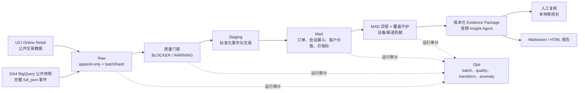

# InsightOps 本地 MVP 最终交接清单

更新时间：2026-08-25。本文只描述已在本机验证的交付，不把公开样例、合成测试或尚未发生的 GitHub 云端运行表述为生产结果。

## 交付状态

| 交付项 | 状态 | 验证证据 |
| --- | --- | --- |
| 本地数据与审计链路 | 已完成 | UCI 541,909 行；完整 GA4 `full_json` 4,295,584 行、92 天，见 `docs/data_access.md` 与 `docs/project_state.md` |
| Raw、Staging、Mart、Ops 分层 | 已完成 | MySQL 8.4 / Docker Compose；完整批次可追溯至 `55c6501e-5403-43a4-b4d5-1a422d87b9d5` |
| 数据质量、漏斗、客户价值、异常守护 | 已完成 | 质量运行 `0d9b0ba3-04fd-4adf-a1c8-e2543c79b01f`，11 条 BLOCKER 通过；完整回归固定 71 / 24 / 47 异常状态 |
| JSON 商品与参数派生 | 已完成 | 3,982,732 商品行、14,821,470 白名单参数行；审计 notebook 已执行 |
| 受限 Agent 与人工复核 | 已完成 | 版本化 Evidence Package、引用约束与本地 Streamlit 审阅流程，详见 `docs/insight_agent.md` 与 `docs/streamlit_review_console.md` |
| HTML/Markdown 报告 | 已完成 | 完整报告在 `artifacts/reports/full_ga4_92d/`；桌面、来源 tooltip、分页与 390px 窄屏 QA 已通过 |
| 本地代码与数据回归 | 已完成 | pytest 22/22；完整批次回归 `PASSED`，收据为 `artifacts/regression/full_ga4_latest.json` |
| GitHub 提交、私人远端与首次云端 CI | 已完成 | 私人 `main` 已推送；首次 CI 的虚拟环境缺陷已由 `f689b31` 修复，第二次 Quality 云端运行通过 |
| 3–5 分钟录屏视频 | 不需要 | 用户明确不需要录制；`docs/demo_runbook.md` 仅作为可选展示材料保留 |

## 架构图



## 最终验证入口

```bash
make test             # 代码、格式、编译与 pytest
make regression       # 14 天开发样例与合成场景的本地只读回归
make regression-full  # 92 天完整 GA4 批次与独立报告的本地只读回归
```

如需重新启动本地审阅台、重导数据或重建报告，优先从 `README.md`、`docs/ga4_full_refresh.md`、`docs/regression_checks.md` 和相应步骤总结开始。不要删除或覆盖既有 Raw 批次；新数据必须使用新的 UUID 和运行审计。

## 固定数据边界

- 所有数据均为公开、匿名化或合成样例，不代表真实企业经营表现。
- 交易号覆盖不均匀；订单、收入和转化相关的异常仅在覆盖守护通过时进入人工复核，仍不构成因果或业务结论。
- JSON 派生表保留 WARNING（商品身份缺失、负金额、参数空值），不得伪造、删除或回写 Raw JSON。
- 本地报告已完成单一浏览器环境的桌面与 390px 窄屏 QA；外网托管、跨浏览器矩阵、无障碍人工验收与多人/RBAC 不在当前 MVP 范围内。

## 后续外部发布顺序

1. 如后续新增功能或数据批次，继续按私有仓库、allowlist 暂存、敏感扫描、本地回归与云端代码 CI 的顺序交付。
3. 仅在外网部署前补齐身份认证、访问控制、集中审阅存储、跨浏览器与无障碍验收。
